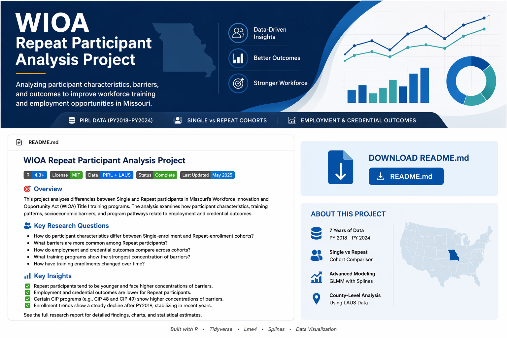

# Workforce Program Analysis

## Project Overview

This project analyzes Workforce Innovation and Opportunity Act (WIOA) participant data to identify factors associated with repeat participation in workforce programs.

The objective was to determine how participant characteristics, service utilization patterns, and program outcomes differed between first-time and repeat participants. The analysis was designed to support evidence-based decision-making and identify opportunities to improve service delivery strategies.

---

## Business Problem

Workforce development programs often serve participants with varying needs, employment barriers, and service histories.

Program staff wanted to better understand:

- Which characteristics are associated with repeat participation
- Whether repeat participants demonstrate different outcomes than first-time participants
- How service delivery strategies could be tailored to participant needs
- What insights historical program data can provide for future planning

The findings help workforce professionals move beyond a one-size-fits-all approach and support more customized participant services.

---

## Data Sources

The analysis used historical workforce program data containing participant demographics, service utilization records, and program outcomes.

Data elements analyzed included:

- Participant demographics
- Education levels
- Employment status
- Barriers to employment
- Program participation history
- Services received
- Program outcomes

To protect confidentiality, all publicly shared materials use aggregate results and anonymized examples.

---

## Analytical Approach

The analysis followed a structured workflow:

1. Data cleaning and preparation
2. Historical trend analysis
3. Participant segmentation
4. First-time vs. repeat participant comparisons
5. Outcome evaluation
6. Identification of service-delivery patterns
7. Development of recommendations

Methods included:

- Descriptive statistics
- Comparative analysis
- Trend analysis
- Workforce program evaluation
- Data visualization

---

## Analysis Workflow

```text
Raw Workforce Data
          │
          ▼
Data Cleaning & Validation
          │
          ▼
Participant Classification
(First-Time vs Repeat)
          │
          ▼
Exploratory Analysis
          │
          ▼
Trend Evaluation
          │
          ▼
Outcome Comparisons
          │
          ▼
Key Findings & Recommendations
```

---

## Key Findings

The analysis identified measurable differences between repeat and first-time participants.

Examples explored included:

- Demographic characteristics
- Employment history patterns
- Service utilization behavior
- Program completion outcomes
- Barriers to employment

The results suggested that participant groups may benefit from different engagement and service strategies.

---

## Recommendations

Based on the analysis, several recommendations were developed:

- Use participant history to support service planning.
- Consider customized service pathways for repeat participants.
- Identify participant groups that may benefit from additional support resources.
- Incorporate historical participation patterns into operational planning.
- Continue monitoring participant outcomes through ongoing reporting and analysis.

---

## Technologies Used

- Python
- SQL
- Pandas
- NumPy
- Jupyter Notebook
- Data Visualization Libraries

---

## Skills Demonstrated

### Data Analysis
- Exploratory Data Analysis (EDA)
- Statistical Analysis
- Trend Analysis
- Workforce Analytics

### Data Management
- Data Cleaning
- Data Validation
- Data Preparation
- SQL Querying

### Business Intelligence
- Program Evaluation
- Stakeholder Reporting
- Decision Support
- Data-Driven Recommendations

---

## Business Impact

This project demonstrates how workforce program data can be used to support:

- Program evaluation
- Service-delivery improvement
- Participant segmentation
- Strategic planning
- Workforce policy discussions
- Evidence-based decision-making

The approach provides a framework for transforming operational data into actionable insights for workforce program administrators and stakeholders.

---

## Repository Contents

```text
/Analysis
/Documentation
/Visualizations
README.md
```

---

## Data Privacy Notice

This repository contains anonymized and publicly shareable project materials.

To protect confidential information:

- No participant-level production data is included.
- Sensitive information has been removed or generalized.
- Results are presented at an aggregate level.
- Documentation focuses on methodology and analytical approach.

---

## Author

Nan Urbonya

Data Analyst specializing in Workforce Analytics, Business Intelligence, SQL, Tableau, and Python.
